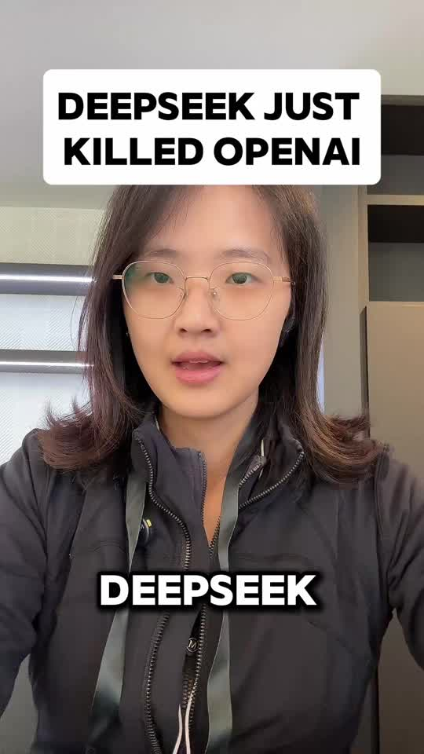

# Koki Short Video Skill

[](README.md) [](README.zh-CN.md) [](README.ja.md)

発話がクリーンで、言語に合った字幕と、トピックに合うビジュアルを備えた、縦型のトーキングヘッド動画を編集するためのスキルです。タイムラインは編集可能なまま残ります。

私自身のクリエイター向けワークフローを切り出し、カスタマイズ可能な公開版としてまとめた単独のスキルです。本READMEは日本語で読めます。スキル本体の手順とワークフロー資料は英語と簡体字中国語で提供しています。

## 完成イメージ

**スマホで撮った映像を、読みやすいタイトル、同期した字幕、関連ビジュアルを備えた縦型動画に仕上げます。** 下のプレビューはすべて私の実際のクリエイタープロジェクトから取ったものです。

<p align="center">
  
  
</p>

左は元の英語編集から取った6秒の無音抜粋で、英語の開始タイトル、大文字の単語字幕、英語の出典スクリーンショットが入っています。右は同じ英語動画の開始フレームです。中国語版READMEには中国語の例が別に載っています。

| 用意するもの | 得られるもの |
| --- | --- |
| リテイクを含むトーキングヘッド素材 | 意味を保ったまま締まった発話編集 |
| 台本と関連する出典資料 | 修正済みの字幕と、タイミングを合わせたビジュアル |
| タイトルと、任意で締めの素材 | 編集可能なプロジェクト内でのカバー／タイトル／締めの処理 |

いずれも実際のプロジェクトのスタイルです。フォント、字幕のリズム、締めは自分のものに設定できます。GIFは小さな無音プレビューで、書き出された動画の全体ではありません。[素材の詳細](docs/media/README.md)。

## クイックスタート

### 1. エディタを接続する

Codex、またはChatCutに接続できる互換エージェントを使います。新規セットアップの場合は、[ChatCut公式のインストールガイド](https://chatcut.io/docs/agent-plugin)に従ってください。デスクトップ版エージェントでは、次のように送れます。

```text
Read ChatCut.io/desktop to install ChatCut
```

ChatCut内でサインインし、エージェントで新しいチャットを開始します。接続を確認するために、ChatCutのプロジェクト一覧を表示するよう依頼してください。ホスト型のWebプロジェクトが既にある場合は、[Web接続ガイド](https://chatcut.io/docs/web-plugin)を使います。

### 2. このスキルをインストールする

Codexに次を貼り付けます。

```text
$skill-installer 次の場所からスキルをインストールしてください：
https://github.com/kokiainet/koki-short-video-skill/tree/main/skills/vertical-talking-head
同名のスキルが既にある場合は保持し、上書きする前に競合を報告してください。
```

インストール後に新しいチャットを開始し、`$vertical-talking-head` で呼び出します。他のAgent Skills互換ツールでも、完全な `skills/vertical-talking-head` フォルダを各自の方法でインストールできます。[Codexのスキルドキュメント](https://learn.chatgpt.com/docs/build-skills)も参照してください。

### 3. 素材と好みを渡す

録画を添付するか、自分のプロジェクト内のローカルパス（例：`./input/talking-head.mp4`）を指定します。任意で、参考台本、タイトル、トピック用メディアのフォルダ、字幕の言語、締めの写真／CTAも追加できます。既存プロジェクトを編集するのか、新規作成するのかも伝えてください。

### 4. 最初のショートを作る

```text
ChatCutと一緒に $vertical-talking-head を使ってください。
素材：./input/talking-head.mp4
9:16の編集可能なプロジェクトを作成してください。音声を控えめにクリーニングし、
失敗したテイク、繰り返しの言い直し、長すぎる間を取り除きながら、意味は保ってください。
字幕は英語の大文字で、1〜2語ずつ、顔にかからない位置に表示してください。
タイトル：[自分のタイトル]。最初のフレームのカバーと開始タイトルを追加してください。
./media/ から関連ビジュアルを探し、対応する発話に合わせてください。
編集可能なプロジェクトとして保存し、プレビューを見せてください。
```

中国語の場合は、字幕の依頼を「自然な中国語のフレーズ字幕を、1枚のカードに1行で」に置き換えます。締めの画像／CTAが渡されていない場合は、その部分は省略してください。

### 5. 修正し、準備ができたら書き出す

```text
現在の発話編集は維持してください。字幕をピクチャーインピクチャーの上に移動し、
出典の文字も私の顔も隠れないようにしてください。合成後のフレームを確認してください。
```

納品されるのは、発話、字幕、タイトル、ビジュアルが別レイヤーになった編集可能なプロジェクトです。ChatCutで開いて手動調整することも、自然言語で修正を続けることもできます。準備ができたら、「現在の版をMP4で書き出して、ダウンロード先を教えて」と依頼してください。

## 自分仕様にする

[creator.example.yaml](creator.example.yaml) を作業プロジェクト内に `creator.local.yaml` としてコピーし、名前、メディアのフォルダ、好みを記入します。エージェントはこのファイルを読みますが、アカウントに接続したり自動で実行したりはしません。私物のメディアや締めの文言が不足している場合は、元の作者のものを借用せず、スキップするか報告します。[PRIVACY.md](PRIVACY.md)も参照してください。

## ツール

これらのワークフローは主に [ChatCut](https://chatcut.io/docs/web-plugin) を使います。まず自分のエージェント環境で公式エディタツールを接続してください。このリポジトリは私個人のカスタムワークフローであり、ChatCut公式プラグインや同梱スキルではありません。デフォルトでは編集可能なプロジェクトとして保存し、書き出しや公開は依頼に応じて行います。外部サービスにはそれぞれの料金と規約があります。

## Kokiについて・連絡先

作成：**Koki**（Anti-Distill Skillの作者、Social Codingの提唱者）。

[Website](https://kokiai.net/) · [X / Twitter](https://x.com/kokiainet) · [Instagram](https://www.instagram.com/kokiainet/) · [YouTube](https://www.youtube.com/@kokiainet) · [LinkedIn](https://www.linkedin.com/in/koki-x-309815217/) · [Substack](https://kokimemo.substack.com/)

コラボレーションや質問は [X](https://x.com/kokiainet) か [LinkedIn](https://www.linkedin.com/in/koki-x-309815217/) でメッセージをください。スキルの不具合や提案は、このリポジトリのIssueでお願いします。私物のメディアやアカウント情報は公開Issueに書かないでください。

## 他のクリエイター向けスキル

- [Koki Writing Skill](https://github.com/kokiainet/koki-writing-skill)
- [Koki Long Video Skill](https://github.com/kokiainet/koki-long-video-skill)

## ライセンス

オリジナルのスキル手順とアダプタコードは [MIT](LICENSE) ライセンスです。サードパーティの製品、フォント、メディア、サービスには、それぞれのライセンスと規約が適用されます。

デモメディアはワークフローの紹介用に含まれています。映像素材、肖像、サードパーティ抜粋の権利は各権利者に帰属し、MITのコードライセンスでは許諾されません。[素材の詳細](docs/media/README.md)を参照してください。
