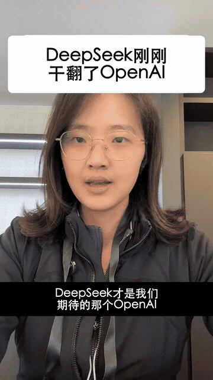
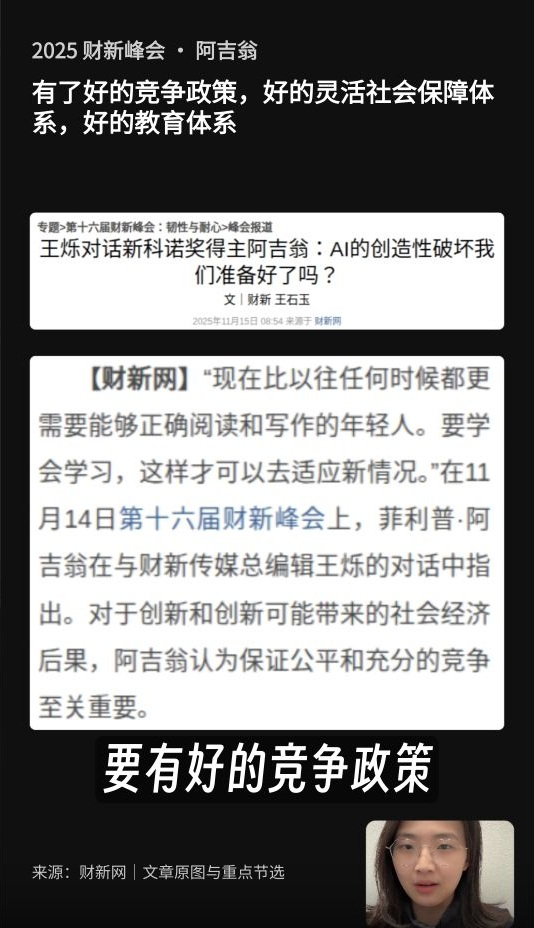

# Koki Short Video Skill

[](README.md) [](README.zh-CN.md)

Edit vertical talking-head videos with clean speech, language-aware captions, topic visuals, and an editable timeline.

A standalone skill from my own creator workflow, shared as a configurable public edition. Instructions and workflow references are available in English and Simplified Chinese.

## See the result

**Turn a phone recording into a vertical video with a readable title, synchronized captions, and relevant visuals.** The previews below come from my actual creator projects.

<p align="center">
  
  
</p>

Left: a six-second silent excerpt showing the title, captions, and transition to a topic screenshot. Right: a source card with highlighted information, subtitles, and the speaker kept visible in a corner.

| You provide | You get |
| --- | --- |
| Talking-head footage, including retakes | A tighter speech edit that keeps the full meaning |
| A script and relevant source material | Corrected captions and timed visuals |
| A title and optional closing assets | A cover/title/closing treatment in an editable project |

These are real project styles; set your own fonts, caption rhythm, and closing. The GIF is a small silent preview, not the full exported video. [Media details](docs/media/README.md).

## Quick start

### 1. Connect the editor

Use Codex or a compatible agent with ChatCut connected. For a new setup, follow [ChatCut's official installation guide](https://chatcut.io/docs/agent-plugin). In the desktop agent you can send:

```text
Read ChatCut.io/desktop to install ChatCut
```

Sign in inside ChatCut, then start a new agent chat. Ask it to list your ChatCut projects to verify the connection. For an existing hosted Web project, use the [Web connection guide](https://chatcut.io/docs/web-plugin).

### 2. Install this skill

Paste the following into Codex:

```text
$skill-installer Install the skill from
https://github.com/leilei926524-tech/koki-short-video-skill/tree/main/skills/vertical-talking-head
Keep an existing skill with the same name and report a conflict before replacing it.
```

Start a new chat after installation, then invoke `$vertical-talking-head`. Other Agent Skills-compatible tools can use the same complete `skills/vertical-talking-head` folder through their own installation method. See [Codex skills documentation](https://learn.chatgpt.com/docs/build-skills).

### 3. Provide footage and preferences

Attach your recording or give a local path in your own project, such as `./input/talking-head.mp4`. Optionally add a reference script, title, topic-media folder, caption language, and closing photos/CTA. Say whether to edit an existing project or create a new one.

### 4. Make your first short

```text
Use $vertical-talking-head with ChatCut.
Footage: ./input/talking-head.mp4
Create a 9:16 editable project. Conservatively clean the voice and remove
failed takes, repeated starts, and excessive pauses while keeping the meaning.
Use natural Chinese phrase captions, one line per card, clear of my face.
Title: [my title]. Add a first-frame cover and opening title.
Find relevant visuals in ./media/ and align them with the matching speech.
Save the editable project and show me the preview.
```

For English, replace the caption request with: “Use English uppercase captions, one or two words at a time.” If no closing images/CTA were supplied, leave that part out.

### 5. Revise, then export when ready

```text
Keep the current speech edit. Move the captions above the picture-in-picture
so neither the source text nor my face is covered. Check the composed frame.
```

You receive an editable project with separate speech, captions, titles, and visuals. Open it in ChatCut to adjust by hand or keep giving natural-language revisions. When ready, ask: “Export the current version as an MP4 and provide the download.”

## Make it yours

Copy [creator.example.yaml](creator.example.yaml) to `creator.local.yaml` in your working project and fill in your name, media directories, and preferences. The agent reads this file; it does not connect accounts or execute by itself. Missing private media or closing text should be skipped or reported, never borrowed from the original author. See [PRIVACY.md](PRIVACY.md).

## Tools

These workflows primarily use [ChatCut](https://chatcut.io/docs/web-plugin). Connect the official editor tools in your agent environment first. This repository contains my custom workflow, not the official ChatCut plugin or its bundled skills. Save an editable project by default; export or publish when requested. External services may have their own fees and terms.

## About Koki & contact

Created by **Koki**, creator of Anti-Distill Skill and initiator of Social Coding.

[Website](https://kokiai.net/) · [X / Twitter](https://x.com/kokisanai) · [Instagram](https://www.instagram.com/kokisanai/) · [YouTube](https://www.youtube.com/@kokiainet) · [LinkedIn](https://www.linkedin.com/in/koki-x-309815217/) · [Substack](https://kokimemo.substack.com/)

For collaborations or questions, message me on [X](https://x.com/kokisanai) or [LinkedIn](https://www.linkedin.com/in/koki-x-309815217/). For a skill bug or suggestion, open an issue in this repository. Please keep private media and account details out of public issues.

## Other creator skills

- [Koki Writing Skill](https://github.com/leilei926524-tech/koki-writing-skill)
- [Koki Long Video Skill](https://github.com/leilei926524-tech/koki-long-video-skill)

## License

Original skill instructions and adapter code are licensed under [MIT](LICENSE). Third-party products, fonts, media, and services retain their own licenses and terms.

Demo media are included for showcasing the workflow; rights in the footage, likenesses, and third-party excerpts remain with their respective owners and are not granted by the MIT code license. See [media details](docs/media/README.md).
