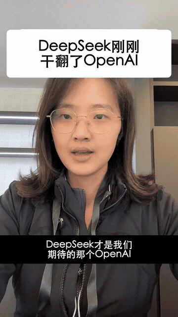
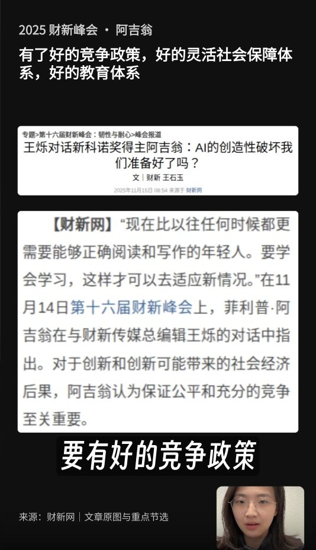

# 短视频创作 Skill

[](README.md) [](README.zh-CN.md) [](README.ja.md)

把单人口播剪成竖屏短视频：降噪、精剪、中英文字幕、首帧封面、主题素材与可编辑时间线。

这是从我的日常创作流程整理出的独立 Skill，公开版已做脱敏并支持自定义。技能说明与流程参考提供英文和简体中文版本，本介绍另有[日语版](README.ja.md)。

## 先看实际效果

**手机录一段口播，就能做成有标题、同步字幕和主题素材的竖屏视频。** 下面都是我自己的实际项目。

<p align="center">
  
  
</p>

左边是六秒无声成片节选，能看到开头标题、字幕与主题截图的切换；右边展示资料卡、重点摘录和人物小窗怎样放在同一屏里。

| 你交给它 | 它帮你完成 |
| --- | --- |
| 包含停顿、重复和重录的口播 | 保留完整意思的精剪 |
| 文稿与相关素材 | 校对后的字幕、对应口播的素材出入点 |
| 标题与可选结尾素材 | 首帧封面、标题、结尾和可继续修改的项目 |

展示的是我实际项目里的样式，你可以换成自己的字体、字幕节奏和结尾。动图只是压缩后的无声预览，完整成片仍在项目里按需导出。[素材说明](docs/media/README.md)。

## 从安装到第一次出结果

### 1. 先接上剪辑工具

使用 Codex 或兼容 Agent，并连接 ChatCut。新安装按 [ChatCut 官方指南](https://chatcut.io/docs/agent-plugin)操作，可以在电脑上的 Agent 对话里发送：

```text
Read ChatCut.io/desktop to install ChatCut
```

在 ChatCut 中登录，再开一个新的 Agent 对话。让它「列出我的 ChatCut 项目」，确认工具已连接。继续编辑已有 Web 项目时，按 [Web 连接指南](https://chatcut.io/docs/web-plugin)操作。

### 2. 安装这个 Skill

在 Codex 里直接粘贴：

```text
$skill-installer 安装这个地址里的技能：
https://github.com/kokiainet/koki-short-video-skill/tree/main/skills/vertical-talking-head
如果已有同名 Skill，先保留并说明冲突，不要直接覆盖。
```

安装后开一个新对话，再用 `$vertical-talking-head` 调用。其他支持 Agent Skills 的工具，可按自己的安装方式导入完整的 `skills/vertical-talking-head` 文件夹。也可查看 [Codex 官方技能文档](https://learn.chatgpt.com/docs/build-skills)。

### 3. 提供原片与偏好

附上录制视频，或给出自己项目中的本地路径，例如 `./input/talking-head.mp4`。可再提供参考文稿、标题、主题素材文件夹、字幕语言、结尾照片与 CTA。说明是继续已有项目，还是新建一条视频。

### 4. 做第一条短视频

```text
用 $vertical-talking-head，通过 ChatCut 剪辑。
原片：./input/talking-head.mp4
新建 9:16 可编辑项目，先保守降噪，删掉失败重录、重复起头和过长停顿，保留完整意思。
中文字幕按自然短语和意思组，一次一行，不挡脸。
标题：[我的标题]。制作首帧封面和开头标题。
从 ./media/ 里找相关素材，放在对应口播的位置。
保存可编辑项目，给我看预览。
```

做英文口播时，把字幕要求改成「英文全大写字幕，每次一到两个词」。没有提供结尾照片和 CTA，就先不加对应部分。

### 5. 继续修改，满意后导出

```text
保留现在的口播剪辑。把字幕移到人物小窗上方，
既不挡资料正文，也不挡脸。检查实际合成画面。
```

最后得到口播、字幕、标题和素材分层的可编辑项目。你可以在 ChatCut 手动调，也可以继续用自然语言修改。满意后再说：「把当前版本导出为 MP4，给我下载文件。」

## 改成自己的风格

将 [creator.example.yaml](creator.example.yaml) 复制为当前项目中的 `creator.local.yaml`，填写自己的称呼、素材目录与偏好。配置供 Agent 读取，不会自行执行或连接账号。未提供的私人素材、结尾图片和 CTA 应跳过或说明，不寻找原作者的素材。隐私处理见 [PRIVACY.md](PRIVACY.md)。

## 工具

主要配合 [ChatCut](https://chatcut.io/docs/web-plugin) 使用，请先在 Agent 环境中连接官方编辑器工具。这里开源的是我的自定义流程，不包含 ChatCut 官方插件及内置技能。默认保存可编辑项目，按明确请求导出或发布；外部服务费用与条款由提供方决定。

## 关于作者与联系

作者：**邓小闲 Koki**，反蒸馏 Skill 作者、社会派编程发起人。

[中文个人网站](https://kokiai.net/zh) · [小红书](https://www.xiaohongshu.com/user/profile/5bfe825044363b01b593585e) · [B站](https://space.bilibili.com/438427470) · [抖音](https://www.douyin.com/user/MS4wLjABAAAAjxdS9GqgpuMLfZGvkM-Kctt6XSkvcr03ouQQv9oNlXHNIC64F4TjKr0cp-dkZcMK)

交流或合作请通过[小红书私信](https://www.xiaohongshu.com/user/profile/5bfe825044363b01b593585e)联系我。技能问题与建议可在本仓库提 issue；请勿在公开 issue 中上传私人素材和账号信息。

## 其他创作 Skill

- [文字创作 Skill](https://github.com/kokiainet/koki-writing-skill)
- [长视频创作 Skill](https://github.com/kokiainet/koki-long-video-skill)

## 开源许可

原创技能说明与适配代码采用 [MIT](LICENSE) 许可。第三方产品、字体、媒体与服务保留各自许可和条款。

演示图片与片段用于展示工作流；原片、人物形象及第三方摘录的权利归相应权利人，不随技能代码授予 MIT 许可。详见[素材说明](docs/media/README.md)。
